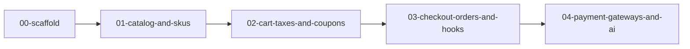

# 🗺️ Project Roadmap — GE Commerce (`wp-hexagonal` · Spec Track A)

## Feature Specs Registry & Dependency Matrix

| ID | Feature Slug | Wave | Depends On | Touches (Isolation Zone) | Spec Path | Status |
|----|--------------|------|------------|--------------------------|-----------|--------|
| `00` | `00-scaffold` | `Wave 0` | None | `ge-commerce.php, composer.json, package.json, src/Core/, src/WordPress/Database/` | [`docs/specs/00-scaffold/`](../specs/00-scaffold/tasks.md) | `[x]` |
| `01` | `01-catalog-and-skus` | `Wave 1` | `00` | `src/Modules/Catalog/, resources/js/admin/catalog/, tests/Unit/Modules/Catalog/` | [`docs/specs/01-catalog-and-skus/`](../specs/01-catalog-and-skus/tasks.md) | `[x]` |
| `02` | `02-cart-taxes-and-coupons` | `Wave 2` | `01` | `src/Modules/Cart/, src/Modules/Coupon/, src/Shared/Contracts/, resources/js/admin/coupons/, tests/Unit/Modules/Cart/, tests/Unit/Modules/Coupon/` | [`docs/specs/02-cart-taxes-and-coupons/`](../specs/02-cart-taxes-and-coupons/tasks.md) | `[>]` |
| `03` | `03-checkout-orders-and-hooks` | `Wave 3` | `02` | `src/Modules/Checkout/, src/Modules/Order/, resources/js/admin/orders/` | [`docs/specs/03-checkout-orders-and-hooks/`](../specs/03-checkout-orders-and-hooks/tasks.md) | `[ ]` |
| `04` | `04-payment-gateways-and-ai` | `Wave 4` | `03` | `src/Modules/Payment/, src/Modules/AiCopilot/, tests/Unit/Modules/Payment/` | [`docs/specs/04-payment-gateways-and-ai/`](../specs/04-payment-gateways-and-ai/tasks.md) | `[ ]` |

