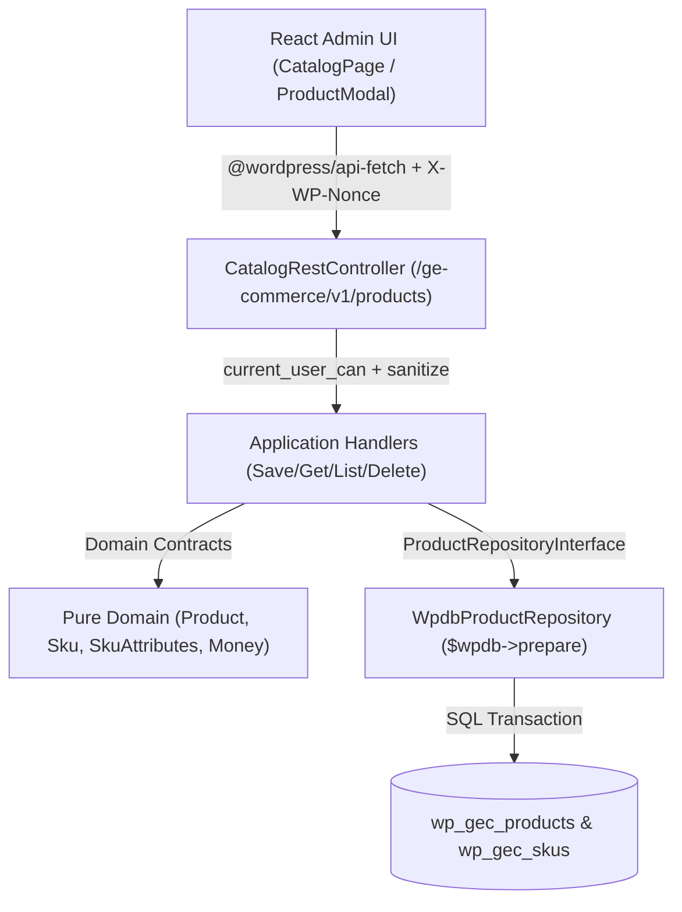

# 📐 Technical Design: Catalog, Variable Attributes & SKUs (`01-catalog-and-skus`)

> **Feature Slug:** `01-catalog-and-skus` · **Requirements:** [`requirements.md`](./requirements.md)  
> **Visual Reference:** [`./design-reference/stitch-prompt.md`](./design-reference/stitch-prompt.md) & [`docs/foundation/design-system.md`](../../foundation/design-system.md)  
> **Blast Radius:** `🟢 ISOLATED` (Self-contained in `src/Modules/Catalog/`, `resources/js/admin/catalog/`, plus 1 provider registration line in `src/Core/Plugin.php`)

---

## 1. Architecture & Data Flow

---

## 2. File Placement, Component Interfaces & Visual Mapping

| Action | Exact File Path | Layer | Responsibility | Validates |
| :--- | :--- | :--- | :--- | :--- |
| `[NEW]` | `src/Modules/Catalog/Domain/ValueObjects/ProductStatus.php` | `[BE]` Domain | Backed enum (`draft`, `published`, `archived`) | `Req 1.1` |
| `[NEW]` | `src/Modules/Catalog/Domain/ValueObjects/SkuAttributes.php` | `[BE]` Domain | Immutable normalized `array<string, string>` + JSON helpers | `Req 1.2` |
| `[NEW]` | `src/Modules/Catalog/Domain/Entities/Sku.php` | `[BE]` Domain | SKU entity with `Money` price (`>= 0`) & non-negative stock | `Req 1.1, 1.2, 1.3` |
| `[NEW]` | `src/Modules/Catalog/Domain/Entities/Product.php` | `[BE]` Domain | Product aggregate root enforcing unique SKU codes & non-empty title/slug | `Req 1.1, 1.2, 1.3` |
| `[NEW]` | `src/Modules/Catalog/Domain/Contracts/ProductRepositoryInterface.php` | `[BE]` Domain | Port interface for Product & SKU persistence | `Req 1.1, 2.1, 2.3` |
| `[NEW]` | `src/Modules/Catalog/Application/DTOs/SkuInputDTO.php` | `[BE]` App | Typed input DTO for SKU creation/update | `Req 1.1, 1.2` |
| `[NEW]` | `src/Modules/Catalog/Application/DTOs/SaveProductDTO.php` | `[BE]` App | Typed input DTO for Product creation/update | `Req 1.1, 1.3` |
| `[NEW]` | `src/Modules/Catalog/Application/Handlers/SaveProductHandler.php` | `[BE]` App | Validates SKU uniqueness, builds aggregate, saves via port | `Req 1.1, 1.2, 1.3` |
| `[NEW]` | `src/Modules/Catalog/Application/Handlers/GetProductHandler.php` | `[BE]` App | Fetches single Product by ID or throws `RuntimeException` | `Req 2.1` |
| `[NEW]` | `src/Modules/Catalog/Application/Handlers/ListProductsHandler.php` | `[BE]` App | Lists paginated Products with optional status filter & total count | `Req 2.1` |
| `[NEW]` | `src/Modules/Catalog/Application/Handlers/DeleteProductHandler.php` | `[BE]` App | Deletes Product & child SKUs by ID | `Req 2.3` |
| `[NEW]` | `src/Modules/Catalog/Infrastructure/Repositories/WpdbProductRepository.php` | `[BE]` Infra | `$wpdb->prepare()` adapter for `wp_gec_products` & `wp_gec_skus` | `Req 1.1, 1.2, 2.1, 2.3` |
| `[NEW]` | `src/Modules/Catalog/Presentation/Rest/CatalogRestController.php` | `[BE]` Pres | REST `/ge-commerce/v1/products` with capability + nonce guards | `Req 1.3, 2.1, 2.2, 2.3` |
| `[NEW]` | `src/Modules/Catalog/Presentation/Providers/CatalogServiceProvider.php` | `[BE]` Pres | DI bindings + `rest_api_init` hook | `Req 1.1, 2.1` |
| `[MODIFY]` | `src/Core/Plugin.php` | `[BE]` Core | Register `CatalogServiceProvider` in `ModuleRegistry` | `Req 2.1` |
| `[NEW]` | `tests/Unit/Modules/Catalog/ProductAndSkuTest.php` | `[BE]` Test | Pure PHP unit tests for Domain & Application handlers | `Req 1.1, 1.2, 1.3, 2.1, 2.3` |
| `[NEW]` | `resources/js/admin/catalog/types.ts` | `[FE]` UI | TypeScript interfaces for Product, SKU, and API payloads | `Req 3.1, 3.2` |
| `[NEW]` | `resources/js/admin/catalog/api.ts` | `[FE]` UI | `@wordpress/api-fetch` client for `/ge-commerce/v1/products` | `Req 3.1, 3.2` |
| `[NEW]` | `resources/js/admin/catalog/ProductModal.tsx` | `[FE]` UI | `@wordpress/components` Modal for Product + dynamic SKU rows | `Req 3.2` |
| `[NEW]` | `resources/js/admin/catalog/CatalogPage.tsx` | `[FE]` UI | Product list table, status filter, badges, `Intl.NumberFormat` | `Req 3.1, 3.2` |
| `[MODIFY]` | `resources/js/admin/index.tsx` | `[FE]` Route | Wrap in `QueryClientProvider` & mount `<CatalogPage />` | `Req 3.1` |

---

## 3. Data Models & API Contracts

### Database Tables (`src/WordPress/Database/Migrator.php`)
- `wp_gec_products`: `id`, `slug` (UNIQUE), `title`, `description`, `status` (`draft|published|archived`), `created_at`, `updated_at`
- `wp_gec_skus`: `id`, `product_id`, `sku_code` (UNIQUE), `attributes_json`, `price_cents` (`bigint >= 0`), `available_qty` (`int >= 0`), `reserved_qty` (`int >= 0`)

### REST Endpoints (`/wp-json/ge-commerce/v1`)
- `GET /products?status=&page=&per_page=` → `200 { ok: true, data: { items: Product[], total: int } }`
- `GET /products/{id}` → `200 { ok: true, data: Product }`
- `POST /products` → `201 { ok: true, data: Product }`
- `PUT /products/{id}` → `200 { ok: true, data: Product }`
- `DELETE /products/{id}` → `200 { ok: true, data: { deleted: true, id: int } }`

---

## 4. Error Handling Matrix

| Category | Trigger | HTTP Status | DB Write? | UI Behavior | Validates |
| :--- | :--- | :--- | :--- | :--- | :--- |
| `auth` | Missing capability (`manage_options` / `manage_ge_commerce`) or invalid nonce | `401` / `403` | No | Show Notice banner | `Req 2.2` |
| `validation` | Empty title/slug, `price_cents < 0`, `available_qty < 0`, duplicate `sku_code` | `400` / `422` | No | Show Notice inside modal; preserve inputs | `Req 1.3` |
| `not_found` | Product ID does not exist on `GET`/`PUT`/`DELETE` | `404` | No | Show error Notice | `Req 2.1, 2.3` |
| `persistence` | `$wpdb` query failure | `500` | No (rollback) | Show retryable error Notice | `Req 1.1` |

---

## 5. Correctness Properties & Verification Strategy

- **Property 1 (Zero-Float & Non-Negative Invariant):** *For any* valid Product and SKU input, `price_cents` and `available_qty` SHALL be persisted as non-negative integers (`int >= 0`) and `attributes_json` SHALL round-trip identically. *(Validates: `Req 1.1, 1.2`)*
- **Property 2 (Invalid / Duplicate Rejection):** *For any* negative price, negative stock, empty title/slug, or duplicate `sku_code`, `Product` / `SaveProductHandler` SHALL throw `InvalidArgumentException` before calling `ProductRepositoryInterface::save()`. *(Validates: `Req 1.3`)*

### Verification Commands
- `php -l <file.php>` on all touched PHP files
- `vendor/bin/phpunit --testsuite Unit`
- `npm run build`
