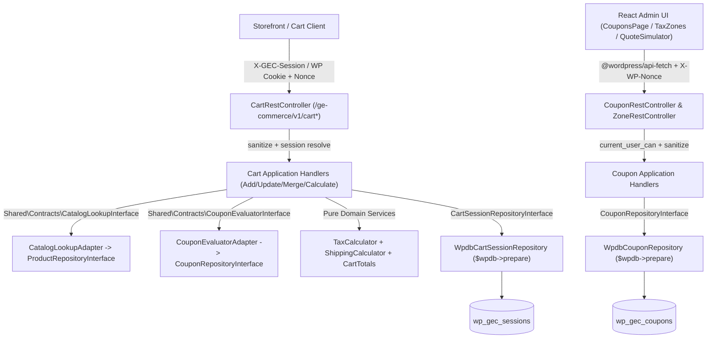

# 📐 Technical Design: Session Cart, Coupons, Tax & Shipping Calculators (`02-cart-taxes-and-coupons`)

> **Feature Slug:** `02-cart-taxes-and-coupons` · **Requirements:** [`requirements.md`](./requirements.md)  
> **Visual Reference:** [`./design-reference/stitch-prompt.md`](./design-reference/stitch-prompt.md) & [`docs/foundation/design-system.md`](../../foundation/design-system.md)  
> **Blast Radius:** `🟡 CONTAINED` (`src/Modules/Coupon/`, `src/Modules/Cart/`, `src/Shared/Contracts/`, `resources/js/admin/coupons/`, plus provider registration in `src/Core/Plugin.php` and `CatalogLookupAdapter` binding in `CatalogServiceProvider.php`)

---

## 1. Architecture & Data Flow

---

## 2. File Placement, Component Interfaces & Visual Mapping

| Action | Exact File Path | Layer | Responsibility | Validates |
| :--- | :--- | :--- | :--- | :--- |
| `[NEW]` | `src/Shared/Contracts/SkuSnapshot.php` | `[BE]` Shared | Immutable cross-module SKU projection (`skuId`, `productId`, `skuCode`, `title`, `priceCents`, `availableQty`, `isPublished`) | `Req 2.1` |
| `[NEW]` | `src/Shared/Contracts/CatalogLookupInterface.php` | `[BE]` Shared | Port for looking up SKU snapshots without importing Catalog internals | `Req 2.1` |
| `[NEW]` | `src/Shared/Contracts/CouponEvaluationResult.php` | `[BE]` Shared | Immutable discount result (`valid`, `code`, `discountCents`, `errorMessage`) | `Req 1.2, 1.3` |
| `[NEW]` | `src/Shared/Contracts/CouponEvaluatorInterface.php` | `[BE]` Shared | Port for validating/computing coupon discount & incrementing usage | `Req 1.2, 1.3` |
| `[NEW]` | `src/Modules/Catalog/Infrastructure/Adapters/CatalogLookupAdapter.php` | `[BE]` Infra | Implements `CatalogLookupInterface` using `ProductRepositoryInterface` / `$wpdb` | `Req 2.1` |
| `[MODIFY]` | `src/Modules/Catalog/Presentation/Providers/CatalogServiceProvider.php` | `[BE]` Pres | Register `CatalogLookupInterface` singleton binding | `Req 2.1` |
| `[NEW]` | `src/Modules/Coupon/Domain/ValueObjects/DiscountType.php` | `[BE]` Domain | Backed enum (`fixed_cents`, `percent_bps`) | `Req 1.1` |
| `[NEW]` | `src/Modules/Coupon/Domain/Entities/Coupon.php` | `[BE]` Domain | Pure Coupon entity enforcing code, min order, usage limit, expiry & clamped `calculateDiscount(Money $subtotal, ?string $nowUtc)` | `Req 1.1, 1.2, 1.3` |
| `[NEW]` | `src/Modules/Coupon/Domain/Contracts/CouponRepositoryInterface.php` | `[BE]` Domain | Port interface for Coupon CRUD & atomic usage increment | `Req 1.1, 1.2` |
| `[NEW]` | `src/Modules/Coupon/Application/DTOs/SaveCouponDTO.php` | `[BE]` App | Typed DTO for saving coupon rules | `Req 1.1` |
| `[NEW]` | `src/Modules/Coupon/Application/Handlers/SaveCouponHandler.php` | `[BE]` App | Validates duplicate code, constructs `Coupon`, persists via port | `Req 1.1, 1.3` |
| `[NEW]` | `src/Modules/Coupon/Application/Handlers/ListCouponsHandler.php` | `[BE]` App | Lists paginated coupons + total count | `Req 4.3` |
| `[NEW]` | `src/Modules/Coupon/Application/Handlers/GetCouponHandler.php` | `[BE]` App | Fetches coupon by ID or throws `RuntimeException` | `Req 1.1` |
| `[NEW]` | `src/Modules/Coupon/Application/Handlers/DeleteCouponHandler.php` | `[BE]` App | Deletes coupon by ID | `Req 4.3` |
| `[NEW]` | `src/Modules/Coupon/Application/Services/CouponEvaluator.php` | `[BE]` App | Implements `CouponEvaluatorInterface` cleanly in pure PHP | `Req 1.2, 1.3` |
| `[NEW]` | `src/Modules/Coupon/Infrastructure/Repositories/WpdbCouponRepository.php` | `[BE]` Infra | `$wpdb->prepare()` adapter for `wp_gec_coupons` | `Req 1.1, 1.2` |
| `[NEW]` | `src/Modules/Coupon/Presentation/Rest/CouponRestController.php` | `[BE]` Pres | REST `/ge-commerce/v1/coupons` guarded by `manage_options || manage_ge_commerce` | `Req 4.1, 4.3` |
| `[NEW]` | `src/Modules/Coupon/Presentation/Providers/CouponServiceProvider.php` | `[BE]` Pres | DI bindings (incl. `CouponEvaluatorInterface`) & `rest_api_init` | `Req 1.1, 4.1` |
| `[NEW]` | `src/Modules/Cart/Domain/ValueObjects/TaxZone.php` | `[BE]` Domain | Immutable TaxZone (`country`, `region`, `rateBps`, `label`) | `Req 3.1` |
| `[NEW]` | `src/Modules/Cart/Domain/ValueObjects/ShippingZone.php` | `[BE]` Domain | Immutable ShippingZone (`country`, `region`, `method`, `flatRateCents`, `freeOverCents`, `label`) | `Req 3.2` |
| `[NEW]` | `src/Modules/Cart/Domain/ValueObjects/CartTotals.php` | `[BE]` Domain | Integer-cent breakdown (`subtotalCents`, `discountCents`, `taxableCents`, `taxCents`, `shippingCents`, `totalCents`, `taxLabel`, `taxRateBps`, `couponWarning`) | `Req 1.2, 3.1, 3.2` |
| `[NEW]` | `src/Modules/Cart/Domain/Entities/CartItem.php` | `[BE]` Domain | Immutable line item (`skuId`, `skuCode`, `title`, `unitPrice`, `qty`, `lineTotal()`) | `Req 2.1` |
| `[NEW]` | `src/Modules/Cart/Domain/Entities/Cart.php` | `[BE]` Domain | Aggregate root (`sessionKey`, `userId`, `items`, `couponCode`, destination, `expiresAt`) with `addItem`, `setItemQty`, `removeItem`, `mergeFrom` | `Req 2.1, 2.2, 2.3` |
| `[NEW]` | `src/Modules/Cart/Domain/Services/TaxCalculator.php` | `[BE]` Domain | Pure integer basis-point tax calculator with zone specificity matching | `Req 3.1` |
| `[NEW]` | `src/Modules/Cart/Domain/Services/ShippingCalculator.php` | `[BE]` Domain | Pure integer shipping calculator with free-over threshold | `Req 3.2` |
| `[NEW]` | `src/Modules/Cart/Domain/Contracts/CartSessionRepositoryInterface.php` | `[BE]` Domain | Port for `wp_gec_sessions` persistence & expiry purge | `Req 2.1, 2.2, 2.3` |
| `[NEW]` | `src/Modules/Cart/Domain/Contracts/ZoneConfigRepositoryInterface.php` | `[BE]` Domain | Port for reading/saving tax & shipping zones | `Req 3.1, 3.2` |
| `[NEW]` | `src/Modules/Cart/Application/DTOs/CartItemInputDTO.php` | `[BE]` App | Input DTO (`skuId`, `qty`) | `Req 2.1` |
| `[NEW]` | `src/Modules/Cart/Application/DTOs/QuotePreviewDTO.php` | `[BE]` App | Input DTO for computing totals on arbitrary items/coupon/destination | `Req 3.1, 3.2, 4.3` |
| `[NEW]` | `src/Modules/Cart/Application/Handlers/GetCartHandler.php` | `[BE]` App | Loads cart (by userId or sessionKey), refreshes live SKU prices, computes `CartTotals` | `Req 2.1, 2.3, 3.1, 3.2` |
| `[NEW]` | `src/Modules/Cart/Application/Handlers/UpdateCartHandler.php` | `[BE]` App | Handles add/update/remove item, coupon apply/remove, destination update with stock & coupon validation | `Req 1.2, 1.3, 2.1` |
| `[NEW]` | `src/Modules/Cart/Application/Handlers/MergeGuestCartHandler.php` | `[BE]` App | Merges guest session cart into authenticated user cart on login and deletes guest session | `Req 2.2` |
| `[NEW]` | `src/Modules/Cart/Application/Handlers/CalculateCartTotalsHandler.php` | `[BE]` App | Pure calculation helper used by both `GetCartHandler` and Admin Quote Simulator | `Req 1.2, 3.1, 3.2` |
| `[NEW]` | `src/Modules/Cart/Application/Handlers/SaveZoneConfigHandler.php` | `[BE]` App | Validates & persists TaxZones and ShippingZones | `Req 3.1, 3.2, 4.3` |
| `[NEW]` | `src/Modules/Cart/Infrastructure/Repositories/WpdbCartSessionRepository.php` | `[BE]` Infra | `$wpdb->prepare()` adapter for `wp_gec_sessions` | `Req 2.1, 2.2, 2.3` |
| `[NEW]` | `src/Modules/Cart/Infrastructure/Repositories/WpZoneConfigRepository.php` | `[BE]` Infra | `wp_options` adapter with sensible default US/international tax & shipping zones | `Req 3.1, 3.2` |
| `[NEW]` | `src/Modules/Cart/Presentation/Rest/CartRestController.php` | `[BE]` Pres | REST `/ge-commerce/v1/cart*` and `/ge-commerce/v1/tax-shipping-zones*` | `Req 2.1, 2.2, 4.1, 4.2` |
| `[NEW]` | `src/Modules/Cart/Presentation/Providers/CartServiceProvider.php` | `[BE]` Pres | DI bindings, `rest_api_init`, and `wp_login` guest-cart merge hook | `Req 2.1, 2.2` |
| `[MODIFY]` | `src/Core/Plugin.php` | `[BE]` Core | Register `CouponServiceProvider` and `CartServiceProvider` | `Req 1.1, 2.1` |
| `[NEW]` | `tests/Unit/Modules/Coupon/CouponTest.php` | `[BE]` Test | Zero-WP unit tests for Coupon creation, clamping, expiry, usage limits, invalid rejection | `Req 1.1, 1.2, 1.3` |
| `[NEW]` | `tests/Unit/Modules/Cart/CartAndTaxTest.php` | `[BE]` Test | Zero-WP unit tests for Cart CRUD, stock clamp, guest-to-user merge, Tax & Shipping calculators | `Req 2.1, 2.2, 2.3, 3.1, 3.2` |
| `[NEW]` | `resources/js/admin/coupons/types.ts` | `[FE]` UI | TypeScript interfaces for Coupon, TaxZone, ShippingZone, CartTotals | `Req 4.3` |
| `[NEW]` | `resources/js/admin/coupons/api.ts` | `[FE]` UI | `@wordpress/api-fetch` client for coupons, zones, and quote preview | `Req 4.3` |
| `[NEW]` | `resources/js/admin/coupons/CouponModal.tsx` | `[FE]` UI | `@wordpress/components` Modal for creating/editing coupons | `Req 1.1, 1.3, 4.3` |
| `[NEW]` | `resources/js/admin/coupons/CouponsAndTaxPage.tsx` | `[FE]` UI | Coupons table, Tax & Shipping Zones panel, and Live Quote Simulator | `Req 4.3` |
| `[MODIFY]` | `resources/js/admin/index.tsx` | `[FE]` Route | Add `Coupons & Tax` tab rendering `<CouponsAndTaxPage />` | `Req 4.3` |

---

## 3. Data Models & API Contracts

### Database Tables (`src/WordPress/Database/Migrator.php` — existing schema)
- `wp_gec_coupons`: `id`, `code` (UNIQUE), `discount_type` (`fixed_cents|percent_bps`), `amount_value` (`bigint`), `min_order_cents` (`bigint`), `usage_limit` (`?int`), `used_count` (`int`), `expires_at` (`?datetime`)
- `wp_gec_sessions`: `session_key` (PK), `user_id` (`bigint`), `cart_json` (`longtext`: `{ items: [{sku_id, qty}], destination: {country, region, shipping_method} }`), `coupon_code` (`?varchar(64)`), `expires_at` (`datetime`)

### REST Endpoints (`/wp-json/ge-commerce/v1`)
- **Admin Coupons (`manage_options || manage_ge_commerce`):**
  - `GET /coupons?page=&per_page=` → `200 { ok: true, data: { items: Coupon[], total: int } }`
  - `POST /coupons` → `201 { ok: true, data: Coupon }`
  - `GET /coupons/{id}` → `200 { ok: true, data: Coupon }`
  - `PUT /coupons/{id}` → `200 { ok: true, data: Coupon }`
  - `DELETE /coupons/{id}` → `200 { ok: true, data: { deleted: true, id: int } }`
- **Admin Zones & Simulator (`manage_options || manage_ge_commerce`):**
  - `GET /tax-shipping-zones` → `200 { ok: true, data: { tax_zones: TaxZone[], shipping_zones: ShippingZone[] } }`
  - `PUT /tax-shipping-zones` → `200 { ok: true, data: { tax_zones: TaxZone[], shipping_zones: ShippingZone[] } }`
  - `POST /cart/quote-preview` → `200 { ok: true, data: CartTotals }`
- **Shopper Cart (`/cart*`):**
  - `GET /cart` → `200 { ok: true, data: { cart: Cart, totals: CartTotals } }`
  - `POST /cart/items` (`{ sku_id, qty }`) → `200 { ok: true, data: { cart: Cart, totals: CartTotals } }`
  - `PUT /cart/items/{sku_id}` (`{ qty }`) → `200 { ok: true, data: { cart: Cart, totals: CartTotals } }`
  - `DELETE /cart/items/{sku_id}` → `200 { ok: true, data: { cart: Cart, totals: CartTotals } }`
  - `POST /cart/coupon` (`{ code }`, empty clears) → `200 { ok: true, data: { cart: Cart, totals: CartTotals } }`
  - `PUT /cart/destination` (`{ country, region, shipping_method }`) → `200 { ok: true, data: { cart: Cart, totals: CartTotals } }`
  - `POST /cart/merge` *(requires `is_user_logged_in()`)* → `200 { ok: true, data: { cart: Cart, totals: CartTotals } }`

---

## 4. Error Handling Matrix

| Category | Trigger | HTTP Status | DB Write? | UI Behavior | Validates |
| :--- | :--- | :--- | :--- | :--- | :--- |
| `auth` | Missing capability (`manage_options`/`manage_ge_commerce`) on admin routes, or guest on `/cart/merge` | `401` / `403` | No | Show Notice banner | `Req 4.1, 4.2` |
| `validation` | Empty/duplicate coupon code, `amount_value < 0`, `percent_bps > 10000`, `qty <= 0`, `qty > available_qty`, invalid/expired coupon | `400` / `422` | No | Show inline Notice; preserve inputs | `Req 1.3, 2.1` |
| `not_found` | Coupon ID or SKU ID does not exist | `404` | No | Show error Notice | `Req 2.1` |
| `persistence` | `$wpdb` query failure | `500` | No (atomic) | Show retryable error Notice | `Req 1.1, 2.1` |

---

## 5. Correctness Properties & Verification Strategy

- **Property 1 (Clamped Integer Discount & Tax Invariant):** *For any* subtotal (`>= 0`), coupon, tax zone (`rate_bps >= 0`), and shipping zone, `discount_cents <= subtotal_cents`, `tax_cents = round_half_up((subtotal - discount) * rate_bps / 10000)`, and `total_cents = (subtotal - discount) + tax_cents + shipping_cents >= 0` using pure integer arithmetic. *(Validates: `Req 1.2, 3.1, 3.2`)*
- **Property 2 (Invalid Rejection & Zero-Drift Merge):** *For any* expired/exhausted/below-minimum coupon, negative amount, `percent_bps > 10000`, or `qty > available_qty`, the domain/application layer SHALL reject before persistence; *for any* guest-to-user merge, overlapping SKU quantities SHALL sum up to `available_qty` and the guest session SHALL be removed. *(Validates: `Req 1.3, 2.1, 2.2, 2.3`)*

### Verification Commands
- `php -l <file.php>` on all touched PHP files
- `vendor/bin/phpunit --testsuite Unit`
- `npx tsc --noEmit && npm run build`
